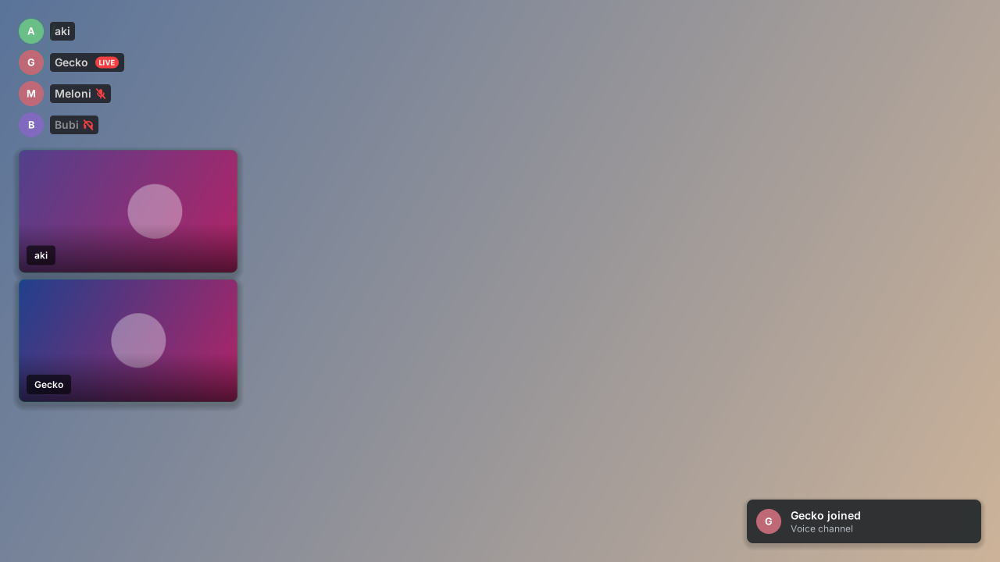

# Vesktop Overlay

An in-game overlay for **Vesktop** voice calls on Linux. It shows who's in your call, who's talking, who's muted, and everyone's **webcams**, on top of your games, the way Discord's Windows overlay does.



## Features

- **Two looks:** Discord (like the Windows overlay, default) and Mac-style frosted cards
- Green ring on whoever is talking
- Mute, deafen, camera and LIVE indicators
- **Webcams**: yours and your friends', as tiles under the list
- "Joined / left" popups
- Click-through, so it never blocks your mouse
- Settings inside Vesktop: position (6 spots, including left/right middle), size, opacity, speaking color, names always / while speaking / never, avatar size, webcam size and FPS
- Show/hide with a keyboard shortcut
- Works on GNOME (X11 and Wayland) and COSMIC; other Wayland desktops get a true overlay layer

## How it works

```
Vesktop ── OverlayBridge plugin ──(127.0.0.1)──▶ Vesktop Overlay app ──▶ on top of your game
```

1. **OverlayBridge** is a Vencord plugin running inside Vesktop. It reads your current call and sends it to the overlay app. Nothing leaves your computer.
2. **Vesktop Overlay** is a small Python/GTK app that draws the transparent overlay window.

`vencord-dist/` contains a ready-made Vencord build that includes the plugin, so you don't need Node.js to install.

## Requirements

- Linux with **Vesktop** (the `.deb` or the Flatpak)
- Python 3 with GTK 3, which the installer adds on Ubuntu, Pop!_OS, Mint and other Debian-based systems
- A desktop with a compositor (GNOME, COSMIC, KDE, etc.)

## Install

1. **Quit Vesktop completely** (right-click its tray icon → Quit).
2. Download and install:
   ```
   git clone https://github.com/Akii-G/vesktop-overlay.git
   cd vesktop-overlay
   ./install.sh
   ```
   No git? Click **Code → Download ZIP** on this page, extract it, and run `./install.sh` inside the folder.
3. Open Vesktop → **Settings → Plugins**, search for **OverlayBridge** and turn it on.
4. Join a voice channel. The overlay appears.

The installer:
- installs `python3-gi`, `python3-gi-cairo` and `gir1.2-gtk-3.0` (it asks for your password),
- installs the overlay app to `~/.local/share/vesktop-overlay` and makes it start at login,
- adds **Vesktop Overlay** and **Vesktop Overlay (preview)** to your app list,
- points Vesktop to the bundled Vencord build (it changes `vencordDir` in Vesktop's `state.json`).

## Settings

In Vesktop: **Settings → Plugins → OverlayBridge → gear icon**.

| Setting | What it does |
|---|---|
| Overlay look | Discord or Mac-style cards |
| Show names | Always, only while speaking, or never |
| Avatar size | Large or small |
| Position | Top/bottom/middle, left or right |
| Overlay size / Card opacity | Scale and transparency |
| Speaking glow color | Hex color, e.g. `#23a55a` (Discord green) |
| Only show people while they talk | Hides silent people (anyone with a cam stays visible) |
| Show webcams / Show your own webcam | Turn the cam tiles on or off |
| Webcam FPS / tile width | Lower values use less CPU |
| Join/leave popups | The small notifications |

App-side settings (monitor, port, margin, font) are in `~/.config/vesktop-overlay/config.json`:

```json
{ "port": 6889, "monitor": 0, "margin": 24, "font": "Inter" }
```

`monitor` is 0 for your first screen and 1 for the second. Restart the overlay after editing.

## Tips

- **Webcams** only show while the call view is open somewhere in Vesktop (another workspace is fine). Discord stops receiving a camera when nothing displays it, so the tile shows the avatar instead.
- **Fullscreen games:** if the overlay disappears in exclusive fullscreen, switch the game to **borderless fullscreen**. It looks the same and the overlay always works there.
- **Show/hide shortcut:** on GNOME, go to Settings → Keyboard → Custom shortcuts, and use the command:
  ```
  pkill -USR1 -f vesktop-overlay.py
  ```
- **Preview the look** without a call: open **Vesktop Overlay (preview)** from your apps, or run `vesktop-overlay --demo`.

## Troubleshooting

**Nothing shows up**
- Make sure the overlay is running: `pgrep -f vesktop-overlay.py`. If it isn't, start it with `vesktop-overlay`.
- Make sure OverlayBridge is enabled in Vesktop and you're in a voice channel.
- If OverlayBridge isn't in the plugin list, Vesktop isn't using the bundled Vencord. Quit Vesktop and run `./install.sh` again.

**A webcam shows the avatar instead of video**
1. Open the call view in Vesktop.
2. If it still doesn't work, press **Ctrl+Shift+I** in Vesktop, open **Console**, run `OverlayBridgeDebug()`, and open an issue with the result.

**The overlay is black instead of transparent**
- Your desktop isn't compositing. Use GNOME, KDE or COSMIC with effects on.

**Port already in use**
- Change `port` in `config.json` and the **port** plugin setting to the same new number.

## Updating

```
cd vesktop-overlay
git pull
./install.sh
```

The bundled Vencord doesn't update itself. To build a fresh Vencord with the plugin (needs Node.js 22+ and pnpm):

```
git clone https://github.com/Vendicated/Vencord && cd Vencord
mkdir -p src/userplugins && cp -r ../vesktop-overlay/plugin/overlayBridge src/userplugins/
pnpm install && pnpm build
cp dist/vencordDesktop* ~/.local/share/vesktop-overlay/vencord/
```

For Flatpak Vesktop, copy to `~/.var/app/dev.vencord.Vesktop/config/vesktop/vencord-overlay/` instead.

## Uninstall

```
./uninstall.sh
```

This removes the overlay and returns Vesktop to its normal, self-updating Vencord.

## Project layout

```
plugin/overlayBridge/   Vencord plugin (index.ts = renderer, native.ts = local connection)
overlay/                The overlay app (Python + GTK 3 + Cairo)
vencord-dist/           Prebuilt Vencord with the plugin included
install.sh / uninstall.sh
```

## License

GPL-3.0, like Vencord. `vencord-dist/` is a build of [Vencord](https://github.com/Vendicated/Vencord) with the OverlayBridge plugin added. Not affiliated with Discord or Vencord.
